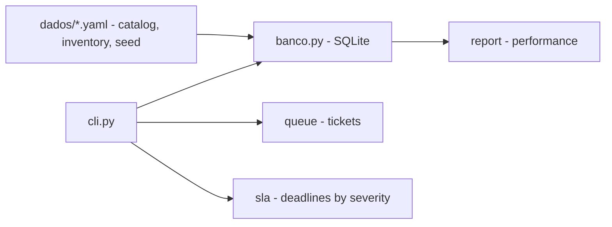

# helpdesk-tickets

**English** · [Português (Brasil)](README.md)

[](#) [](#) [](#) [](#) [](#.github/workflows/ci.yml) [](LICENSE)

## What it is

A **local IT service desk** to manage support tickets: a queue with per-severity SLAs, an asset inventory, a service catalog and a performance report. It runs on **SQLite** with YAML seed data. It is an educational IT/support lab in Python.

## Status

An educational lab, working and tested (82 tests).

## Features

- **Ticket queue** with severity (critical, high, medium, low) and SLA deadlines.
- **Per-severity SLA** on two clocks: **first-response deadline** and **resolution deadline** (e.g. critical = 1h response, 4h resolution; low = 24h / 96h).
- **Asset inventory** and **service catalog** (YAML seeds).
- **Performance report**: SLA met, backlog, MTTR and recurring assets.
- **CLI**: `abrir` (open), `listar`, `responder`, `resolver`, `inv`, `rel`, `srv` — all on local SQLite.
- **Priority matrix** and ticket best practices documented in `docs/`.

## Architecture

A `helpdesk` package with `fila.py` (tickets), `sla.py` (severity/deadlines), `inventario.py`, `banco.py` (SQLite), `relatorio.py` (performance), `servidor.py` and `cli.py`. YAML seeds in `dados/`.



## Stack

- Python ≥ 3.10
- PyYAML ≥ 6.0 (only dependency)
- SQLite (stdlib `sqlite3`)
- pytest (dev)
- CI: GitHub Actions

## Repository layout

```
helpdesk-tickets/
├── pyproject.toml · requirements.txt
├── dados/
│   ├── catalogo-servicos.yaml
│   ├── chamados-semente.yaml
│   └── inventario-semente.yaml
├── src/helpdesk/
│   ├── banco.py · fila.py · sla.py · inventario.py
│   ├── modelo.py · relatorio.py · servidor.py · cli.py
├── docs/                 # priority matrix, how to write a good ticket
├── exemplos/             # performance report
├── tests/                # 82 tests
└── LICENSE               # MIT
```

## Prerequisites and installation

Python ≥ 3.10.

```bash
pip install -e .
```

## How to run

```bash
helpdesk abrir --titulo "..." --solicitante "Nome" [--severidade alta] [--categoria ...] [--ativo ...]
helpdesk listar
helpdesk responder <id> --texto "..."
helpdesk resolver <id>
helpdesk inv
helpdesk rel
helpdesk srv
```

The default database is `dados/helpdesk.sqlite`; the YAML seeds are in `dados/`.

## Tests and quality

Real command (verified by the agent):

```bash
python -m pytest tests/
# 82 passed
```

- CI (`ci.yml`): runs the suite on windows-latest (Python 3.11).

## Technical decisions and trade-offs

- **SLA measured on two clocks** (response and resolution): mirrors real support operations; the matrix is in `docs/matriz-de-prioridade.md`.
- **Local SQLite + YAML seeds**: simple and self-contained; in exchange, no multi-user or central server.
- **Deterministic report** (configurable reference time): comparable across runs.

## Known limitations and roadmap

- Local database; no authentication/multi-user.
- Metrics (MTTR, backlog) depend on the loaded data.
- No e-mail/real notification integration.

## Development process

An individual project by Kelvin Oliveira, built with orchestrated AI agents and reviewed by the author. The queue, the SLA model and the review are the author's.

## License and author

MIT — Copyright (c) 2026 Kelvin Rebelo de Oliveira.

**Author**: [Kelvin Oliveira](https://github.com/KelvinOliveiraCode) · [Portfolio](https://kelvinoliveiracode.github.io/portfolio/)
