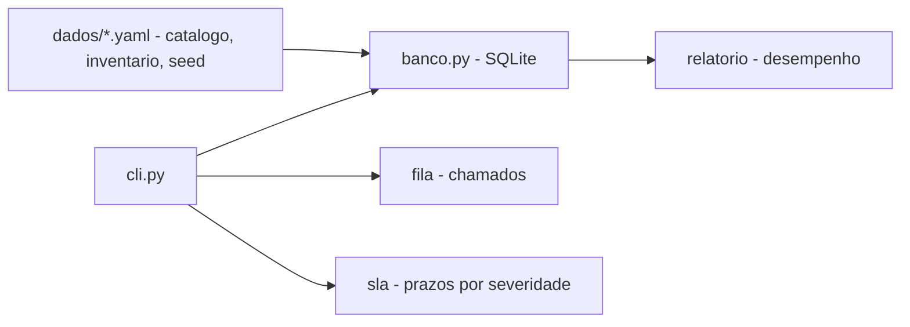

# helpdesk-tickets

[English](README.en.md) · **Português (Brasil)**

[](#) [](#) [](#) [](#) [](#.github/workflows/ci.yml) [](LICENSE)

## O que é

**Service desk local** para gerenciar chamados de suporte de TI: fila com SLA por severidade, inventário de ativos, catálogo de serviços e relatório de desempenho. Opera com **SQLite** e dados de semente em YAML. É um laboratório educacional de TI/suporte em Python.

## Status

Laboratório educacional funcional e testado (82 testes).

## Funcionalidades

- **Fila de chamados** com severidade (crítica, alta, média, baixa) e prazos de SLA.
- **SLA por severidade** em dois relógios: **prazo de primeira resposta** e **prazo de resolução** (ex.: crítica = resposta em 1h, resolução em 4h; baixa = 24h / 96h).
- **Inventário de ativos** e **catálogo de serviços** (seeds YAML).
- **Relatório de desempenho**: SLA atingido, backlog, MTTR e ativos recorrentes.
- **CLI**: `abrir`, `listar`, `responder`, `resolver`, `inv`, `rel`, `srv` — tudo em SQLite local.
- **Matriz de prioridade** e boas práticas de chamado documentadas em `docs/`.

## Arquitetura

Pacote `helpdesk` com `fila.py` (chamados), `sla.py` (prazos/severidade), `inventario.py`, `banco.py` (SQLite), `relatorio.py` (desempenho), `servidor.py` e `cli.py`. Seeds YAML em `dados/`.



## Stack

- Python ≥ 3.10
- PyYAML ≥ 6.0 (única dependência)
- SQLite (stdlib `sqlite3`)
- pytest (dev)
- CI: GitHub Actions

## Estrutura do repositório

```
helpdesk-tickets/
├── pyproject.toml · requirements.txt
├── dados/
│   ├── catalogo-servicos.yaml
│   ├── chamados-semente.yaml
│   └── inventario-semente.yaml
├── src/helpdesk/
│   ├── banco.py · fila.py · sla.py · inventario.py
│   ├── modelo.py · relatorio.py · servidor.py · cli.py
├── docs/                 # matriz de prioridade, como escrever um bom chamado
├── exemplos/             # relatório de desempenho
├── tests/                # 82 testes
└── LICENSE               # MIT
```

## Pré-requisitos e instalação

Python ≥ 3.10.

```bash
pip install -e .
```

## Como executar

```bash
helpdesk abrir --titulo "..." --solicitante "Nome" [--severidade alta] [--categoria ...] [--ativo ...]
helpdesk listar
helpdesk responder <id> --texto "..."
helpdesk resolver <id>
helpdesk inv
helpdesk rel
helpdesk srv
```

O banco padrão é `dados/helpdesk.sqlite`; os seeds YAML ficam em `dados/`.

## Testes e qualidade

Comando real (verificado pelo agente):

```bash
python -m pytest tests/
# 82 passed
```

- CI (`ci.yml`): roda a suíte em windows-latest (Python 3.11).

## Decisões técnicas e trade-offs

- **SLA medido em dois relógios** (resposta e resolução): reflete a operação real de suporte; a matriz está em `docs/matriz-de-prioridade.md`.
- **SQLite local + seeds YAML**: simples e auto-contido; em troca, sem multiusuário nem servidor central.
- **Relatório determinístico** (referência de tempo configurável): comparável entre execuções.

## Limitações conhecidas e roadmap

- Banco local; sem autenticação/multiusuário.
- As métricas (MTTR, backlog) dependem dos dados carregados.
- Sem integração com e-mail/notificação real.

## Processo de desenvolvimento

Projeto individual de Kelvin Oliveira, construído com agentes de IA orquestrados e revisado pelo autor. A fila, o modelo de SLA e a revisão são do autor.

## Licença e autor

MIT — Copyright (c) 2026 Kelvin Rebelo de Oliveira.

**Autor**: [Kelvin Oliveira](https://github.com/KelvinOliveiraCode) · [Portfólio](https://kelvinoliveiracode.github.io/portfolio/)
